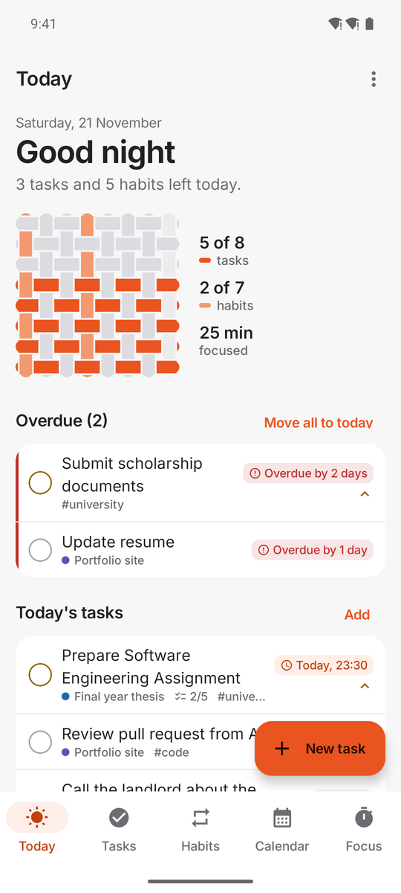
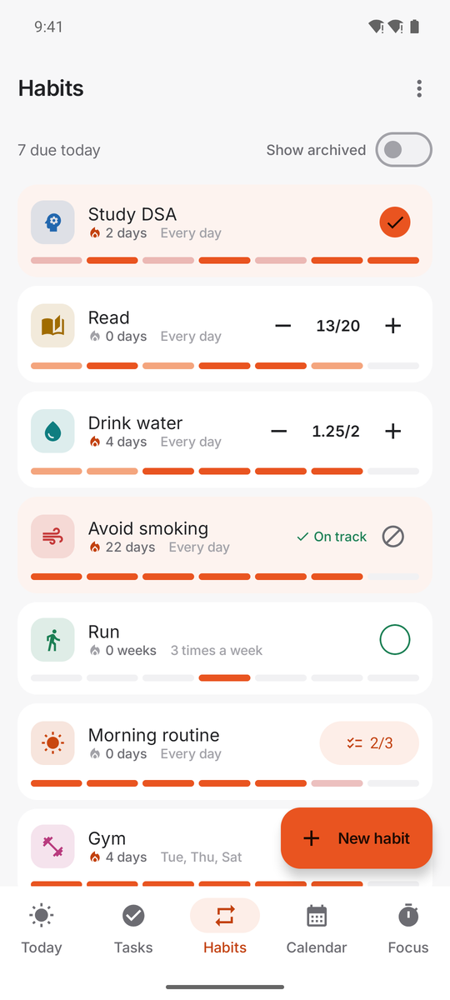
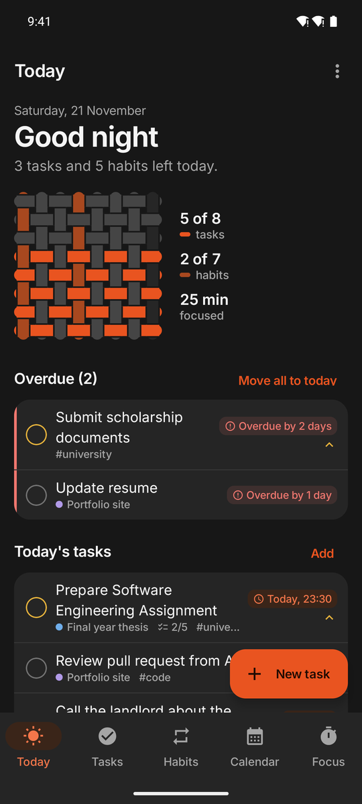
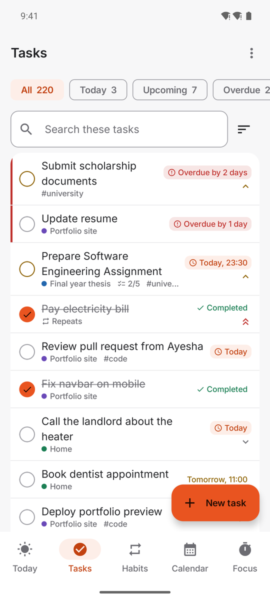
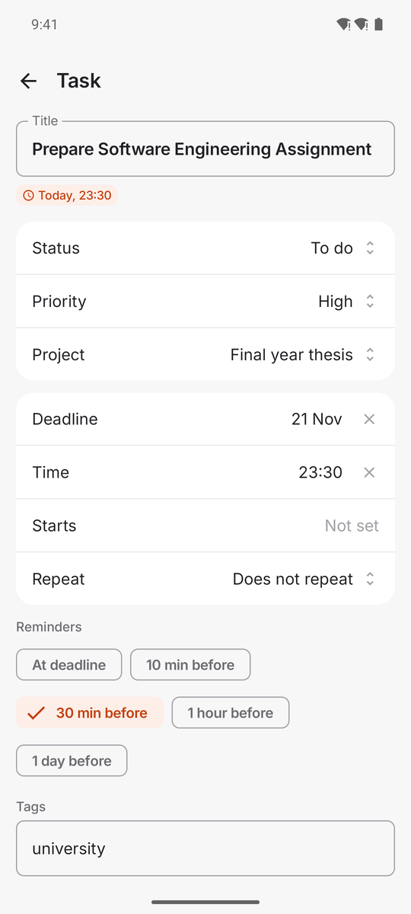
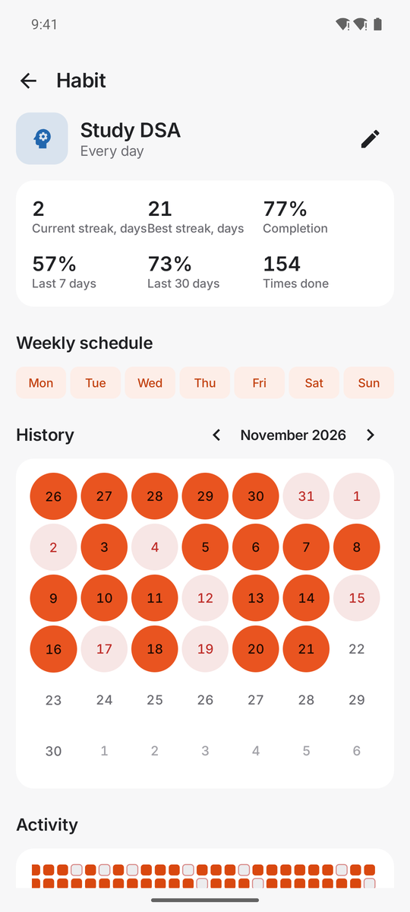
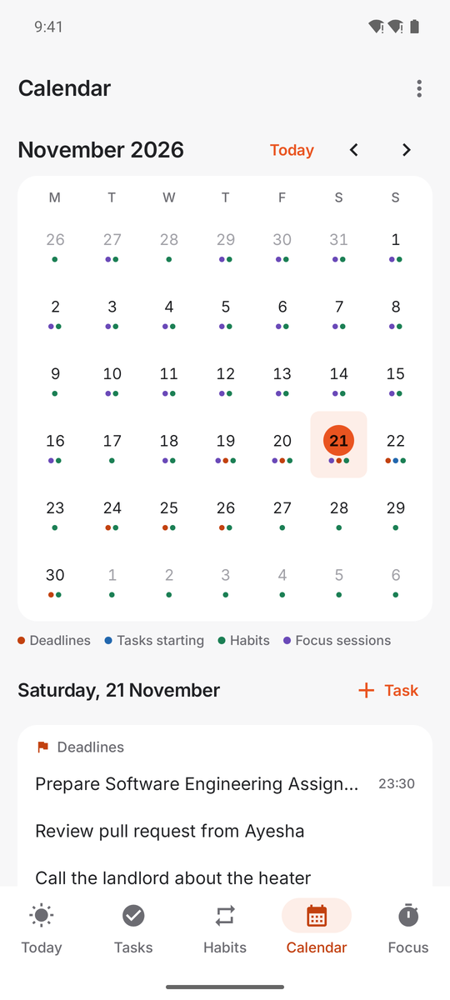
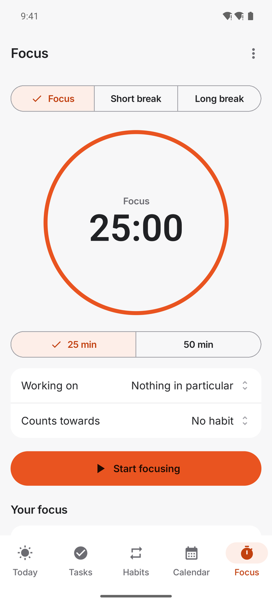
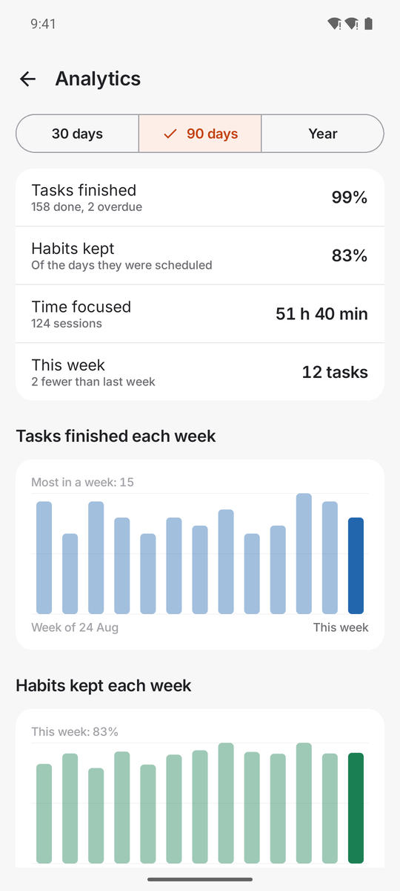

<div align="center">


# Dayweave for Android

**Build better days, one habit at a time.**

Tasks, deadlines, habits, a calendar, focus sessions and analytics, together in one private app.
Everything stays on your phone.

</div>

<p align="center">
  
  
  
</p>

This is the Android companion to [Dayweave for Ubuntu](https://github.com/ammarqaisar11a55/Dayweave). Both run
the same Rust core, so deadlines, streaks, reminders and analytics follow exactly the same rules, and a
backup from one opens in the other.

## Your day, as a piece of cloth

In weaving, the warp threads stay fixed on the loom and the weft passes through them. A day works the
same way: habits are the threads that stay, and tasks are what passes through. Today draws the day as a
small piece of weave, and each thread fills with colour as you finish it.

## Features

- **Tasks.** Priorities, statuses, projects, tags, subtasks, repeating tasks and several reminders
  each. Deadlines are described honestly: "Today" for a date, "In 10 min" for a time.
- **Habits.** Build, quit, measure or check off, on set days or a weekly target, with streaks, a
  month of history and a year's heatmap.
- **Calendar.** A month at a glance with everything due, starting, done and focused each day.
- **Focus.** Focus sessions and breaks that keep counting while the app is closed, with a live
  countdown in the notification shade.
- **Analytics.** Completion, consistency and focus time over 30 days, 90 days or a year.
- **Reminders.** On the minute, with Complete and Snooze buttons right on the notification, and
  rescheduled after a restart or a change of time zone.
- **Backups.** Save a full backup, a database copy or CSV exports anywhere through Android's file
  picker, and restore after seeing exactly what the file holds.
- **Sync, when you want it.** Sign in under Settings → Sync to keep this phone in step with Dayweave
  on your computer. Everything works offline, and changes sync when you're back online. When the same
  thing changed on two devices, the later change wins.
- **Updates.** Dayweave checks this repository's releases once a day and installs new versions
  itself, after checking each download's checksum and signature.
- **Light and dark themes,** following the system or chosen in Settings.

<p align="center">
  
  
  
  
</p>
<p align="center">
  
  
</p>

## Install

Download the latest `Dayweave-<version>.apk` from
[Releases](https://github.com/ammarqaisar11a55/Dayweave-Android/releases/latest) and open it. Android asks
you to allow installing from your browser or file manager the first time. After that, Dayweave updates
itself: Settings → Updates.

Android 8.0 or newer is needed. For reminders to arrive on the minute, allow **Alarms and reminders**
when Dayweave asks.

## Privacy

No account needed, no tracking and no ads. Your data stays on the phone unless you turn on sync or save
a backup. Without sync, the only network request Dayweave makes is the daily check of this
repository's releases.
See [PRIVACY.md](PRIVACY.md).

## Building

You need JDK 17, the Android SDK with NDK 26.1.10909125, and Rust with the Android targets:

```bash
git clone --recurse-submodules https://github.com/ammarqaisar11a55/Dayweave-Android.git
```

```bash
sh scripts/apply-core-patches.sh
```

```bash
rustup target add aarch64-linux-android x86_64-linux-android
```

```bash
./gradlew assembleDebug
```

Add `-PrustAbis=x86_64` to build the core only for the emulator. See [ARCHITECTURE.md](ARCHITECTURE.md)
for how the pieces fit together, and [docs/VERIFICATION.md](docs/VERIFICATION.md) for what has been tested.

## Licence

[MIT](LICENSE). The Inter typeface is under the [SIL Open Font License](licenses/Inter-OFL.txt).
